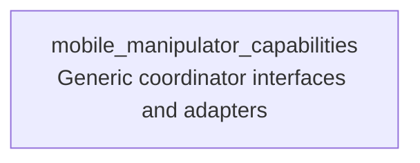

# mobile_manipulator_capabilities

Capability-layer adapters for the generic mobile-manipulator ROS APIs.

## Purpose

This package maps capability inputs and outputs onto the runtime server in `mobile_manipulator_ros`.

## Ownership Boundary

- `grasping` owns scene activation, active planning-scene state, arm-only feasibility, and arm execution
- `mobile_manipulator` owns generic arm-plus-base orchestration, candidate generation and selection, and mobile-manipulator execution policy
- `mobile_manipulator_capabilities` stays a thin adapter layer over the generic ROS services and action

This package should not parse `workspace.yaml`, own `scenes.yaml`, or implement robot-specific mobile-manipulator policy directly. It should translate capability requests into the generic runtime APIs and return their results.

## Runners

- `CheckTaskFeasibilityRunner`: calls `mobile_manipulator_msgs/srv/CheckTaskFeasibility`
- `FindFeasiblePoseRunner`: calls `mobile_manipulator_msgs/srv/FindFeasiblePose`
- `ExecuteTaskPoseRunner`: calls `mobile_manipulator_msgs/action/ExecuteTaskPose`

## Capability inheritance

## Example Plans

- [plans/manipulation_1.xml](./plans/manipulation_1.xml): direct task-feasibility check for a target pose with no supplied base pose.
- [plans/manipulation_2.xml](./plans/manipulation_2.xml): task-feasibility check with an explicit mobile base pose.
- [plans/manipulation_3.xml](./plans/manipulation_3.xml): feasible-pose search that asks the mobile-manipulator stack to generate and validate candidate base poses.
- [plans/manipulation_4.xml](./plans/manipulation_4.xml): execute an already validated task pose with an approved base pose.